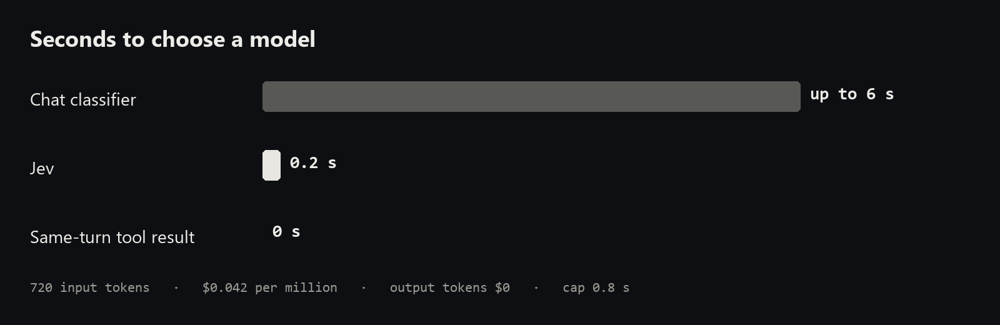

# jev-llmcall

<p align="center">
  
</p>

<p align="center">You hand it a sentence and the models you allow. It hands back one model id and a reasoning effort.</p>

## What it is

| You bring | You get back |
|---|---|
| A TypesafeAI key | `model_id` |
| The user's sentence, cut at 1,500 characters | `reasoning_effort` |
| Model ids you are willing to call | Estimated price of that card |

Keys for Anthropic, OpenAI, Google, and xAI stay in your client. Jev only reads the sentence. The price table in this repo picks the card.

## Why it matters

The model choice used to be its own chat call.



| | Time | Jev's bill |
|---|---|---|
| Chat classifier | up to 6 s | a chat model, input and output |
| Jev | 0.2 s, cap 0.8 s | $0.042 / 1M input tokens, output $0 |
| Same-turn tool result | no call | $0 |

## Strong points, and the limits

| | |
|---|---|
| Speed | 0.2 s against a 6 s ceiling, about 30× |
| Price | about 720 input tokens a call. Output is not billed |
| Boundary | it cannot return an id that has no price card |
| Late or down | at 0.8 s it returns the cheapest card that is not economy. That may not be Jev's pick |
| What leaves | up to 1,500 characters of the prompt go to TypeSafe |
| Weak quality | priced at 2× list. A rule, not a measured retry rate |

## Install and run

Python 3.10 or newer. The key comes from the [TypeSafe console](https://console.typesafe.ai/keys).

```powershell
pip install -e .
$env:TYPESAFE_API_KEY = "the key from the console"
python -m jev_llmcall --prompt "Design a ledger that cannot double-charge." --models "claude-sonnet-5-5,gpt-6.1-sol,grok-4.7"
```

```python
from jev_llmcall import Router

decision = Router().select(
    "Design a ledger that cannot double-charge.",
    ["claude-sonnet-5-5", "gpt-6.1-sol", "grok-4.7"],
    input_tokens=1800,
)
```

`decision.model_id` is the model. `decision.reasoning_effort` is the effort to request. Pass `needs_tools=True` or `needs_image=True` when the reply has to. For a tool result in the same turn, pass `continue_turn=True` and `previous_model`. That path does not call Jev.

MIT.
